<p align="center">
  
</p>

<p align="center">
  <strong>Anonymous, room-based P2P file sharing & real-time chat</strong>
</p>

<p align="center">
  
  
  
  
  
</p>

---

## What is QuickDrop?

QuickDrop is a **zero-signup, anonymous** file sharing and chat application. Create a room, share the link, and start transferring files **directly between browsers** using WebRTC — no cloud storage, no accounts, no traces left behind.

Files travel **peer-to-peer** through encrypted WebRTC data channels. The signaling server only brokers the initial connection — your data never touches it.

---

## Features

### Room System
- **Create rooms** with a password — public or private
- **Join rooms** by entering room ID + password, or clicking a shared link
- **Public room lobby** — browse and join open rooms with live user counts
- **Auto-generated room IDs** — short, readable, unique

### Real-Time Chat
- **Instant messaging** relayed through WebSocket
- **Anonymous usernames** — no sign-up required
- **Message persistence** — chat history survives page refreshes (sessionStorage)
- **System messages** — join/leave notifications

### P2P File Transfer
- **Direct browser-to-browser** transfer via WebRTC DataChannel
- **Chunked streaming** — handles large files with progress tracking
- **In-browser preview** — images, text, PDFs viewable without downloading
- **Download with one click** — save received files instantly
- **No file size server limit** — files never touch the server

### Design & UX
- **Dark & Light themes** — toggle with smooth transitions
- **Responsive layout** — works on desktop and mobile
- **LAN support** — use on the same network from any device
- **Session persistence** — room state, chat, and file list survive refreshes
- **Reconnect support** — refresh without incrementing member count

---

## Tech Stack

| Layer | Technology |
|-------|-----------|
| **Frontend** | React 18 + TypeScript + Vite |
| **State** | Zustand (with sessionStorage persistence) |
| **Styling** | CSS Modules + CSS Variables (theme system) |
| **Signaling** | Deno (WebSocket server) |
| **P2P** | WebRTC (RTCPeerConnection + RTCDataChannel) |
| **Chat Relay** | WebSocket |
| **Routing** | React Router v6 |

---

## Architecture

```
┌─────────────┐         WebSocket          ┌─────────────┐
│   Peer A     │◄──────────────────────────►│  Signaling   │
│  (Browser)   │    signaling + chat        │   Server     │
└──────┬───────┘                            │   (Deno)     │
       │                                    └──────┬───────┘
       │  WebRTC DataChannel (P2P)                 │
       │  ─────────────────────────►               │
       │  ◄─────────────────────────               │
       │        file transfer                      │
┌──────┴───────┐         WebSocket          ┌──────┴───────┐
│   Peer B     │◄──────────────────────────►│              │
│  (Browser)   │    signaling + chat        │              │
└──────────────┘                            └──────────────┘
```

**How it works:**
1. **Room creation** — Client calls REST API to create a room with a password
2. **Joining** — Client opens WebSocket to signaling server with room ID + password
3. **Signaling** — Server relays WebRTC offers/answers/ICE candidates between peers
4. **P2P connection** — Browsers establish direct RTCPeerConnection
5. **File transfer** — Files are chunked and streamed through RTCDataChannel
6. **Chat** — Messages relayed through the WebSocket server (not P2P)

---

## Project Structure

```
quickdrop/
├── client/                     # React frontend
│   ├── public/
│   │   ├── logo.svg            # App logo (gradient drop icon)
│   │   ├── favicon.svg         # Browser tab icon
│   │   └── readme-cover.svg    # Animated README cover
│   ├── src/
│   │   ├── components/
│   │   │   ├── home/
│   │   │   │   ├── CreateRoom.tsx      # Room creation modal
│   │   │   │   └── ActiveRooms.tsx     # Public rooms lobby
│   │   │   ├── room/
│   │   │   │   ├── ChatPanel.tsx       # Chat message list + input
│   │   │   │   ├── FilePanel.tsx       # File send/receive UI
│   │   │   │   └── RoomHeader.tsx      # Room info + controls
│   │   │   ├── layout/
│   │   │   │   └── Layout.tsx          # Nav bar + theme toggle
│   │   │   └── ui/
│   │   │       └── ThemeToggle.tsx     # Dark/light mode switch
│   │   ├── hooks/
│   │   │   ├── useWebSocket.ts         # WS connection + reconnect
│   │   │   └── useWebRTC.ts            # P2P file transfer logic
│   │   ├── stores/
│   │   │   ├── roomStore.ts            # Room state (persisted)
│   │   │   ├── chatStore.ts            # Chat messages (persisted)
│   │   │   └── fileStore.ts            # File entries (persisted)
│   │   ├── lib/
│   │   │   └── api.ts                  # Dynamic API/WS URLs
│   │   ├── pages/
│   │   │   ├── Home.tsx                # Landing page
│   │   │   └── Room.tsx                # Room page (chat + files)
│   │   ├── styles/
│   │   │   └── theme.css               # Global theme variables
│   │   ├── App.tsx                     # Router setup
│   │   └── main.tsx                    # Entry point
│   ├── .env                            # VITE_API_URL (empty = auto-detect)
│   ├── package.json
│   ├── tsconfig.json
│   └── vite.config.ts
├── server/                     # Deno signaling server
│   ├── main.ts                 # HTTP + WebSocket server entry
│   ├── handlers/
│   │   ├── roomHandler.ts      # REST API for room CRUD
│   │   └── wsHandler.ts        # WebSocket signaling + chat relay
│   ├── services/
│   │   └── roomService.ts      # Room state management
│   └── utils/
│       └── utils.ts            # JSON response helpers
└── README.md
```

---

## Getting Started

### Prerequisites

- **Node.js** 18+ and **npm**
- **Deno** 1.38+ (for the signaling server)

### 1. Clone the repository

```bash
git clone https://github.com/your-username/quickdrop.git
cd quickdrop
```

### 2. Start the signaling server

```bash
cd server
deno run --allow-net --allow-read main.ts
```

Server starts on `http://0.0.0.0:8080`

### 3. Start the frontend

```bash
cd client
npm install --legacy-peer-deps
npm run dev
```

Frontend starts on `http://localhost:5173`

### 4. Open in browser

- **Same machine:** `http://localhost:5173`
- **Other devices on LAN:** `http://<your-ip>:5173`  
  (Find your IP: `ipconfig` on Windows, `ifconfig` on Mac/Linux)

---

## Usage

### Create a Room
1. Click **"Create Room"** on the home page
2. Set a **password** (required for joining)
3. Toggle **public** if you want the room visible in the lobby
4. Share the **room link** with others

### Join a Room
- Click a room in the **public lobby**, or
- Enter a **Room ID + password** manually, or
- Open a **shared link** directly

### Send Files
1. Switch to the **Files** tab in the room
2. Click **"Choose File"** or drag and drop
3. File transfers **directly** to all peers in the room
4. Recipients can **preview** or **download** received files

### Chat
- Switch to the **Chat** tab
- Type a message and hit **Enter** or click **Send**
- Messages are delivered instantly to all room members

---

## LAN / Mobile Access

QuickDrop automatically detects your network address. To use from a phone or another device on the same WiFi:

1. Start both the **server** and **client** on your computer
2. Find your local IP (`ipconfig` → IPv4 Address)
3. On your phone, open: `http://<your-ip>:5173`

> **Note:** File transfer uses WebRTC which requires either HTTPS or localhost for full `crypto` API support. On HTTP over LAN, QuickDrop uses a fallback ID generator that works everywhere.

---

## Theme

QuickDrop comes with a carefully crafted **dark theme** (default) and **light theme**.

| Token | Dark | Light |
|-------|------|-------|
| Background | `#07070d` Midnight Black | `#f5f5f7` |
| Primary | `#3b5bff` Electric Cobalt | `#3b5bff` |
| Accent | `#c8ff00` Acid Lime | `#8fb300` |
| Surface | `#12121c` | `#ffffff` |
| Text | `#e8e8ed` | `#1a1a2e` |

Toggle between themes using the **sun/moon** button in the navigation bar.

---

## Security & Privacy

- **No accounts** — completely anonymous usage
- **No server storage** — files never touch the server
- **P2P encryption** — WebRTC DTLS encrypts data channels
- **Session-only data** — everything is gone when you close the tab
- **No tracking** — zero analytics, zero cookies, zero fingerprinting
- **Password-protected rooms** — only those with the password can join

---

## API Reference

### REST Endpoints

| Method | Endpoint | Description |
|--------|----------|-------------|
| `POST` | `/api/rooms` | Create a new room |
| `POST` | `/api/rooms/:id/join` | Join an existing room |
| `GET` | `/api/rooms/public` | List public rooms |

### WebSocket

Connect to: `ws://<host>:8080/ws?room=<roomId>&pwd=<password>`

**Message types:**

| Type | Direction | Description |
|------|-----------|-------------|
| `joined` | Server → Client | Assigned userId + room member list |
| `peer-joined` | Server → Client | New peer entered the room |
| `peer-left` | Server → Client | Peer left the room |
| `chat` | Bidirectional | Chat message relay |
| `offer` | Client → Server → Client | WebRTC SDP offer |
| `answer` | Client → Server → Client | WebRTC SDP answer |
| `ice-candidate` | Client → Server → Client | ICE candidate exchange |

---

## Roadmap

- [ ] Drag & drop file upload
- [ ] Multiple file transfer queue
- [ ] File transfer progress for receiver
- [ ] End-to-end encryption (beyond WebRTC DTLS)
- [ ] Room expiry / auto-cleanup
- [ ] Deploy to Deno Deploy + Vercel
- [ ] QR code room sharing
- [ ] Voice/video chat

---

## Contributing

1. Fork the repository
2. Create a feature branch: `git checkout -b feature/amazing-feature`
3. Commit your changes: `git commit -m "feat: add amazing feature"`
4. Push to the branch: `git push origin feature/amazing-feature`
5. Open a Pull Request

---

## License

This project is licensed under the **MIT License** — see the [LICENSE](LICENSE) file for details.

---

<p align="center">
  
  <br />
  <strong>QuickDrop</strong> — Drop files. Not data.
  <br />
  <sub>Built with WebRTC, React, and Deno</sub>
</p>
